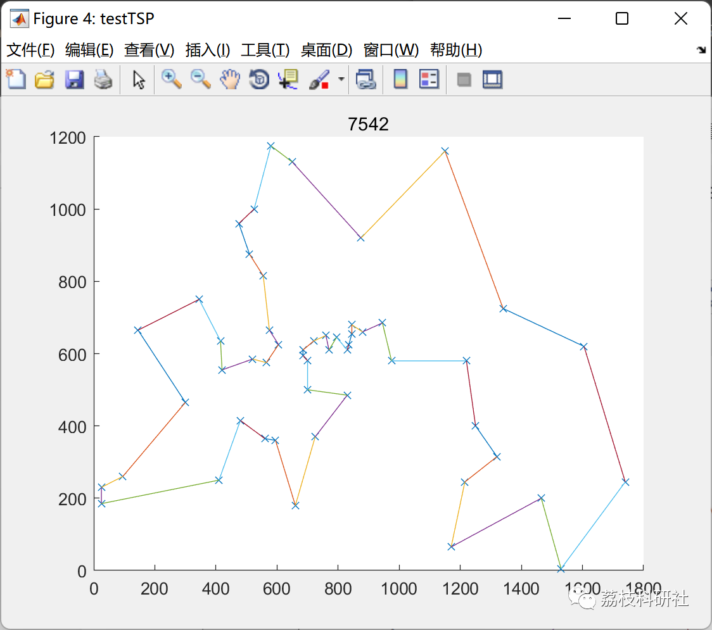

# Adaptive dynamic neighborhood cuckoo search algorithm for solving TSP problem (Matlab code implementation)

1 Abstract
To address the issues of low neighborhood search efficiency and the tendency to fall into local optima when solving the Traveling Salesman Problem using the dispersion-based cuckoo search algorithm, an Adaptive Dynamic Neighborhood Hybrid Cuckoo Search algorithm (ADNHCS) is proposed. To enhance the efficiency of neighborhood search, a circularly restricted mutation dynamic neighborhood structure is designed to reduce the randomness of classical algorithms; moreover, a strategy for adaptively adjusting parameters based on iterative sub-rows is introduced, combined with the taboo search algorithm to improve the capability of global optimization.Several classic benchmark problems were used to conduct experimental simulations of the algorithm performance using MATLAB and standard TSPLIB data. The results indicate that compared with other bird-based algorithms, classical and novel swarm intelligence optimization algorithms, the ADNHCS algorithm exhibits superior global search capability and stability.
Detailed article click the text below left "Read more"  
2 Run results  
3 Matlab code implementation
% Cuckoo calculates all\nfunction [B] = crossover(Mdl,A,B,D,choice,gem)      \n    switch choice\n        case 1              % 2-opt neighborhood\n            for i=1:20\n                tmpB = B(1,2:size(B,2));\n                fitbest = fitness(B,D);\n                len = size(tmpB,2);                 % Segment length\n                avelen = fitbest/len;\n                avelen = avelen*2;\n                getpoint = tmpB(1,randperm(len,1)); % Randomly select points\n                [X] = A(getpoint,2:3);\n                Idx = rangesearch(Mdl,X,avelen);    % Calculate nearest neighbor\n                as = cell2mat(Idx);\n                chose = intersect(as,tmpB);         % Exclude the first one\n                if size(chose,2) == 1\n                    point1 = find(tmpB == chose(1,1));\n                    point2 = getpoint;\n                else\n                    getpoint = randperm(size(chose,2),2);\n                    point1 = find(tmpB == chose(getpoint(1,1)));\n                    point2 = find(tmpB == chose(getpoint(1,2)));\n                end\n                \n                if point1 > point2\n                    tmp = point1;\n                    point1 = point2;\n                    point2 = tmp;              \n                end\n                if point2 == point1+1 \n                    if point2 == len\n                        --point1;\n                    else\n                        ++point2;\n                    end\n                end\n                a2 = point1;\n                a1 = a2-1;\n                b2 = point2;\n                b1 = b2-1;\n                \n                sec1 = tmpB(1,1:a1);                % Take the first part\n                secfli1 = fliplr(sec1);             % First part in reverse order\n                \n                sec2 = tmpB(1,a2:b1);               % Take the second part\n                secfli2 = fliplr(sec2);             % Second part in reverse order\n                \n                sec3 = tmpB(1,b2:size(tmpB,2));     % Extract the third part\n                secfli3 = fliplr(sec3);             % Third part in reverse order\n                \n                subans1 = [secfli1';sec2';sec3']';  % a'bc = ac'b'\n                subans2 = [sec1';secfli2';sec3']';  % ab'c\n                subans3 = [sec1';sec2';secfli3']';  % abc'\n                \n                AnsSub(3*(i-1)+1).seris = [1 subans1];\n                AnsSub(3*(i-1)+1).changef = 1;\n                AnsSub(3*(i-1)+1).changel = len+1;\n                AnsSub(3*(i-1)+2).seris = [1 subans2];\n                if a1 == 0\n                    a1 = 1;\n                end\n                AnsSub(3*(i-1)+2).changef = a1;\n                AnsSub(3*(i-1)+2).changel = len+1;\n                AnsSub(3*(i-1)+3).seris = [1 subans3];\n                AnsSub(3*(i-1)+3).changef = b1;\n                AnsSub(3*(i-1)+3).changel = len+1;\n            end\n            [E] = returnbest(AnsSub,D,fitbest,1,gem);\n            if E ~= 0\n               B = E;\n            end\n​\n       case 2            % 3opt(dynamic)\n           for i=1:20\n               tmpB=B(1,2:size(B,2));\n               fitbest = fitness(B,D);\n               len = size(tmpB,2);                  % Segment length\n               avelen = fitbest/len;\n               avelen = avelen*3;\n               getpoint = tmpB(1,randperm(len,1));\n               [X] = A(getpoint,2:3);\n               Idx = rangesearch(Mdl,X,avelen);\n               as = cell2mat(Idx);\n               chose = intersect(as,tmpB);          % Exclude the first one\n​\n               if size(chose,2) <= 6\n                   [vec] = 2:len-4;\n                   getpoint = vec(randperm(length(vec),1));\n                   a2 = getpoint(1);\n                   a1 = a2-1;\n                   sec1 = tmpB(1,1:a1);             % Take the first part\n                   secfli1 = fliplr(sec1);          % First part in reverse order\n                   \n                   [vec] = a2+2:len-2;\n                   getpoint = vec(randperm(length(vec),1));\n                   b2 = getpoint(1);\n                   b1 = b2-1;\n                   sec2 = tmpB(1,a2:b1);           % Take the second part\n                   secfli2 = fliplr(sec2);         % Second part in reverse order\n                   \n                   [vec] = b2+2:len;\n                   getpoint = vec(randperm(length(vec),1));\n                   c2 = getpoint(1);\n                   c1 = c2-1;\n                   sec3 = tmpB(1,b2:c1);           % Take the third part\n                   secfli3 = fliplr(sec3);         % Third part in reverse order\n                   \n                   sec4 = tmpB(1,c2:len);          % Extract the fourth part\n                   secfli4 = fliplr(sec4);         % Part Four: Reverse\n               else % The candidate set is large enough\n                  for cnt=1:size(chose,2)\n                      candplc(1,cnt) = find(tmpB == chose(1,cnt));\n                  end\n                  candplcsort = sort(candplc);\n                  lencand = size(candplcsort,2);\n                  [vec] = 2:lencand-4;              % Index candidate truncation position\n                  getpoint = randperm(length(vec),1); % Find the index\n                  gpa = vec(1,getpoint);            % Corresponding to the original position\n                  a2 = candplcsort(1,gpa);          % Candidate mappings\n                  a1 = a2-1;\n                  sec1 = tmpB(1,1:a1);              % Take the first part\n                  secfli1 = fliplr(sec1);           % First part in reverse order\n                  \n                  [vec] = gpa+2:lencand-2;\n                  getpoint = randperm(length(vec),1);\n                  gpb = vec(1,getpoint);\n                  b2 = candplcsort(1,gpb);\n                  b1 = b2-1;\n                  sec2 = tmpB(1,a2:b1);             % Take the second part\n                  secfli2 = fliplr(sec2);           % Second part in reverse order\n                  \n                  [vec] = gpb+2:lencand;\n                  getpoint = randperm(length(vec),1);\n                  gpc = vec(1,getpoint);\n                  c2 = candplcsort(1,gpc);\n                  c1 = c2-1;\n                  sec3 = tmpB(1,b2:c1);             % Take the third part\n                  secfli3 = fliplr(sec3);           % Third part in reverse order\n                  \n                  sec4 = tmpB(1,c2:len);            % Extract the fourth part\n                  secfli4 = fliplr(sec4);           % Fourth part in reverse order\n               end\n              subans1 = [sec1';secfli2';secfli3';sec4']';           %ab'c' = a'cb\n              subans2 = [secfli1';secfli2';sec3';secfli4']';        %a'b'c\n              subans3 = [secfli1';sec2';secfli3';secfli4']';        %a'bc'\n              subans4 = [secfli1';secfli2';secfli3';secfli4']';     %a'b'c'\n              \n               AnsSub(4*(i-1)+1).seris = [1 subans1];\n                if a1 == 0\n                    a1 = 1;\n                end\n                AnsSub(4*(i-1)+1).changef = a1;\n                AnsSub(4*(i-1)+1).changel = len+1;\n                AnsSub(4*(i-1)+2).seris = [1 subans2];\n                AnsSub(4*(i-1)+2).changef = 1;\n                AnsSub(4*(i-1)+2).changel = len+1;\n                AnsSub(4*(i-1)+3).seris = [1 subans3];\n                AnsSub(4*(i-1)+3).changef = 1;\n                AnsSub(4*(i-1)+3).changel = len+1;\n                AnsSub(4*(i-1)+4).seris = [1 subans4];\n                AnsSub(4*(i-1)+4).changef = 1;\n                AnsSub(4*(i-1)+4).changel = len+1;\n          end\n              [E] = returnbest(AnsSub,D,fitbest,1,gem);\n              if E ~= 0\n                  B = E;\n              end\n  \n        case 3            %3opt(No dynamic)\n            for i=1:20\n                tmpB=B(1,2:size(B,2));\n                fitbest = fitness(B,D);\n                len = length(tmpB);         % Segment length\n                \n                [vec] = 2:len-4;\n                getpoint = vec(randperm(length(vec),1));\n                a2 = getpoint(1);\n                a1 = a2-1;\n                sec1 = tmpB(1,1:a1);         % Take the first part\n                secfli1 = fliplr(sec1);     % First part in reverse order\n                \n                [vec] = a2+2:len-2;\n                getpoint = vec(randperm(length(vec),1));\n                b2 = getpoint(1);\n                b1 = b2-1;\n                sec2 = tmpB(1,a2:b1);        % Take the second part\n                secfli2 = fliplr(sec2);     % Second part in reverse order\n                \n                [vec] = b2+2:len;\n                getpoint = vec(randperm(length(vec),1));\n                c2 = getpoint(1);\n                c1 = c2-1;\n                sec3 = tmpB(1,b2:c1);        % Take the second part\n                secfli3 = fliplr(sec3);     % Second part in reverse order\n                \n                sec4 = tmpB(1,c2:len);       % Take the third part\n                secfli4 = fliplr(sec4);     % Third part in reverse order\n                \n                subans1 = [sec1';secfli2';secfli3';sec4']';       %ab'c' = a'cb\n                subans2 = [secfli1';secfli2';sec3';secfli4']';       %a'b'c\n                subans3 = [secfli1';sec2';secfli3';secfli4']';       %a'bc'\n                subans4 = [secfli1';secfli2';secfli3';secfli4']';       %a'b'c'\n                \n                AnsSub(4*(i-1)+1).seris = [1 subans1];\n                AnsSub(4*(i-1)+1).changef = a1;\n                AnsSub(4*(i-1)+1).changel = len+1;\n                AnsSub(4*(i-1)+2).seris = [1 subans2];\n                AnsSub(4*(i-1)+2).changef = 1;\n                AnsSub(4*(i-1)+2).changel = len+1;\n                AnsSub(4*(i-1)+3).seris = [1 subans3];\n                AnsSub(4*(i-1)+3).changef = 1;\n                AnsSub(4*(i-1)+3).changel = len+1;\n                AnsSub(4*(i-1)+4).seris = [1 subans4];\n                AnsSub(4*(i-1)+4).changef = 1;\n                AnsSub(4*(i-1)+4).changel = len+1;\n            end\n            [E] = returnbest(AnsSub,D,fitbest,1,gem);\n            if E ~= 0\n                B = E;\n            end\n            \n        case 4            %Double Bridge\n            for i=1:20\n                tmpB=B(1,2:size(B,2));\n                fitbest = fitness(B,D);\n                len = length(tmpB);         % Segment length\n                \n                [vec] = 2:len-6;\n                getpoint = vec(randperm(length(vec),1));\n                a2 = getpoint(1);\n                a1 = a2-1;\n                sec1 = tmpB(1,1:a1);         % Take the first part\n                secfli1 = fliplr(sec1);     % First part in reverse order\n                \n                [vec] = a2+2:len-4;\n                getpoint = vec(randperm(length(vec),1));\n                b2 = getpoint(1);\n                b1 = b2-1;\n                [vec] = b2+2:len-2;\n                sec2 = tmpB(1,a2:b1);        % Take the second part\n                secfli2 = fliplr(sec2);     % Second part in reverse order\n                \n                getpoint = vec(randperm(length(vec),1));\n                c2 = getpoint(1);\n                c1 = c2-1;\n                [vec] = c2+2:len;\n                sec3 = tmpB(1,b2:c1);       % Take the third part\n                secfli3 = fliplr(sec3);     % Third part in reverse order\n                \n                getpoint = vec(randperm(length(vec),1));\n                d2 = getpoint(1);\n                d1 = d2-1;\n                sec4 = tmpB(1,c2:d1);       % Take the fourth part\n                secfli4 = fliplr(sec4);     % Part Four: Reverse\n                \n                sec5 = tmpB(1,d2:len);      % Take the fifth part\n                secfli5 = fliplr(sec5);     % Part 5 Reverse\n                \n                subans1 = [sec1';sec4';sec3';sec2';sec5']';       %Double Bridge\n                subans2 = [secfli1';sec4';secfli3';sec2';secfli5']';\n                subans3 = [secfli1';sec2';secfli3';sec4';secfli5']';\n                subans4 = [sec1';secfli4';sec3';secfli2';sec5']';\n                subans5 = [sec1';secfli2';sec3';secfli4';sec5']';\n                \n                AnsSub(5*(i-1)+1).seris = [1 subans1];\n                AnsSub(5*(i-1)+1).changef = a1;\n                AnsSub(5*(i-1)+1).changel = len+1;\n                AnsSub(5*(i-1)+2).seris = [1 subans2];\n                AnsSub(5*(i-1)+2).changef = 1;\n                AnsSub(5*(i-1)+2).changel = len+1;\n                AnsSub(5*(i-1)+3).seris = [1 subans3];\n                AnsSub(5*(i-1)+3).changef = 1;\n                AnsSub(5*(i-1)+3).changel = len+1;\n                AnsSub(5*(i-1)+4).seris = [1 subans4];\n                AnsSub(5*(i-1)+4).changef = a1;\n                AnsSub(5*(i-1)+4).changel = len+1;\n                AnsSub(5*(i-1)+5).seris = [1 subans5];\n                AnsSub(5*(i-1)+5).changef = a1;\n                AnsSub(5*(i-1)+5).changel = len+1;\n            end\n            [E] = returnbest(AnsSub,D,fitbest,1,gem);\n            if E ~= 0\n                B = E;\n            end\n    end\n \n% Calculate the optimal solution\nfunction [E] = returnbest(C,D,fitbest,opt,gem)\n    global tabulist;\n    E = [];\n    arraylength = size(C,2);\n    tabulength = size(tabulist,2);\n    for i=1:arraylength                     % 2 opt optimization\n        genbe = C(i).seris;      \n        if opt == 1\n            totalen = size(genbe,2);\n            startpos = C(i).changef;\n            endpos = C(i).changel;\n            if startpos + 3 > totalen\n                startpos = startpos - 3;\n            end\n            flag = 1;\n            if rand < 0.2 + 0.3 * (1/(1+exp(-(gem-400)/10)))    %dropout\n                flag = 0;\n            end\n            while flag\n                flag=0;\n                for x=startpos:endpos-3\n                    for j=x+2:endpos-1\n                            if D(genbe(1,x),genbe(1,j))+D(genbe(1,x+1),genbe(1,j+1))<D(genbe(1,x),genbe(1,x+1))+D(genbe(1,j),genbe(1,j+1))\n                                genbe(1,(x+1):j)=genbe(1,j:-1:(x+1));\n                                flag=1;\n                        end\n                    end\n                end\n            end\n        end\n        neighborhood(i).list = genbe;     % Candidate set of city sequences\n        fitnessc = fitness(genbe,D);\n        neighborhood(i).value= fitnessc;\n    end\n    candidate_next= sort(cat(1, neighborhood.value), 1).'; % Sort the target values of the candidate set in ascending order\n    \n    if candidate_next(1) < fitbest               %Satisfies the disrespect criteria\n       index = find(cat(1, neighborhood.value)==candidate_next(1)); % Find the position of the object corresponding to the minimum target value\n       L = length(index); % There might be more than one minimum value\n       if L > 1 % If there are more than one minimum values, choose the latter\n           candidate_now.list = neighborhood(index(L)).list;\n       else % Only one minimum value\n           candidate_now.list = neighborhood(index(1)).list;\n       end\n       candidate_now.value = candidate_next(1);\n        \n       for i = tabulength-1:-1:1              % Update the taboo table\n           tabulist(i+1).list = tabulist(i).list;\n           tabulist(i+1).value = tabulist(i).value;\n       end\n       tabulist(1).list = candidate_now.list;\n       tabulist(1).value = candidate_now.value;\n       E = tabulist(1).list;\n    else\n       for n = 1:size(candidate_next,1)\n           if candidate_next(1) > ceil(fitbest*1.07)    % Early Stop\n               return;\n           end\n           index = find(cat(1, neighborhood.value)==candidate_next(n));\n           tx = neighborhood(index(1)).list;\n           % Check if in the taboo list\n           flag = true;\n           for i = 1:tabulength\n               if tabulist(i).value == 0\n                   continue;\n               else\n                   tkp = abs(tx - tabulist(i).list);\n                   flag = flag & sum(tkp)>0;\n               end       \n           end\n           if flag\n              candidate_now.list = tx;\n              candidate_now.value = candidate_next(n);\n              % Put this object into the taboo list\n              for i = tabulength-1:-1:1\n                  tabulist(i+1).list = tabulist(i).list;\n                  tabulist(i+1).value = tabulist(i).value;\n              end\n              tabulist(1).list = candidate_now.list;\n              tabulist(1).value = candidate_now.value;\n              break;\n          end\n       end\n    end\n   \nClick the text at the bottom left corner to see the complete code.“Read the full text.”  
Or reply with the keyword: Adaptive dynamic neighborhood cuckoo search hybrid algorithm for solving TSP problem
4. References
[1] Chen Lei, Zhang Hongmei, Zhang Xiangli. Adaptive dynamic neighborhood cuckoo search hybrid algorithm for solving TSP problem [J]. Computer Engineering and Applications, 2018, 54(23): 42-50

## Images

<!-- PAYMENT_BLOCK -->

## Get this dataset

- Payment link (Stripe): [Buy now](https://buy.stripe.com/3cs8yP7sY87d0vu9AB)
- Payment QR code: 

<!-- /PAYMENT_BLOCK -->
